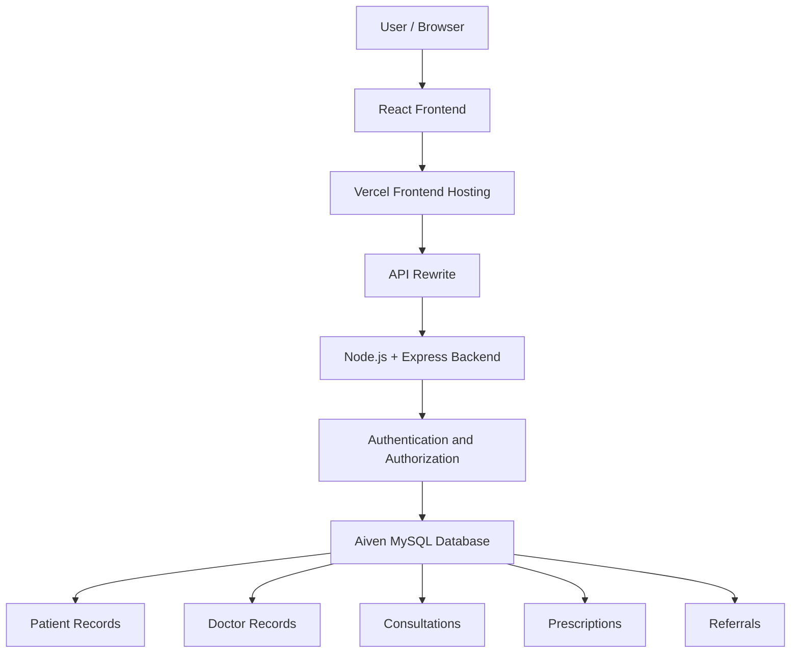

# MediTrail – Digital Patient Medical Record & Referral Management System

<p align="center">
  
  
  
  
</p>

<p align="center">
  A centralized digital healthcare platform designed to simplify patient medical records, doctor consultations, prescriptions, and medical referrals.
</p>

<p align="center">
  <a href="https://meditrail-frontend-rho.vercel.app">Live Application</a> •
  <a href="https://med-trail.vercel.app/api/health">Backend API</a> •
  <a href="https://github.com/sunnysaini2004/MedTrail">GitHub Repository</a>
</p>

---

## 1. Introduction

**MediTrail** is a web-based Digital Patient Medical Record and Referral Management System designed to make healthcare information more accessible, organized, and manageable.

It provides a centralized platform where patients' medical records, consultation history, prescriptions, and referrals can be maintained digitally.

Instead of depending entirely on physical medical files and paperwork, MediTrail helps authorized healthcare professionals access relevant patient information through a centralized system.

The platform provides three primary user roles:

- **Admin:** Manages hospital operations, doctors, patients, and system settings.
- **Doctor:** Manages assigned patients, consultations, prescriptions, and referrals.
- **Patient:** Registers, accesses personal medical information, and follows their treatment journey.

## 2. Problem Statement

Traditional healthcare systems often depend on physical medical records, printed prescriptions, and manually maintained patient files.

This creates several challenges:

- **Lost or damaged medical records:** Patients may lose important medical documents and previous prescriptions.
- **Fragmented medical history:** Medical information is distributed across different hospitals, clinics, and physical files.
- **Difficult referrals:** Transferring patient information between doctors and specialists can involve unnecessary paperwork.
- **Time-consuming processes:** Doctors may need additional time to review previous medical records.
- **Limited accessibility:** Patients may need to carry physical documents whenever they visit another healthcare provider.
- **Manual record management:** Maintaining and organizing large numbers of patient records can become difficult for hospital administrators.

### Proposed Solution

MediTrail addresses these challenges by providing a centralized digital platform for managing patient medical information.

It allows authorized users to maintain, organize, and access patient records, consultations, prescriptions, and referrals through a structured web application.

The goal is to reduce paperwork, improve information accessibility, and make patient record management more efficient.

## 3. Project Objectives

- Digitize patient medical records.
- Provide a centralized patient information management system.
- Simplify doctor-patient assignment and management.
- Maintain consultation and prescription history.
- Support digital medical referrals.
- Provide role-based access for administrators, doctors, and patients.
- Improve the organization and accessibility of healthcare information.
- Reduce dependency on physical medical documents.

## 4. User Roles and Responsibilities

### Admin Dashboard

The administrator manages the hospital's overall platform operations.

Responsibilities include:

- Manage doctor accounts.
- Register and manage patient accounts.
- Assign patients to doctors.
- View and manage doctor and patient records.
- Manage hospital contact information and settings.
- Monitor and manage administrative activities.
- Manage user accounts and access.

### Doctor Dashboard

Doctors manage their assigned patients and treatment activities.

Responsibilities include:

- View assigned patients.
- Access authorized patient medical information.
- Record patient consultations.
- Add prescriptions and prescribed medicines.
- Create medical referrals.
- Review patient treatment history.
- Maintain consultation records.

### Patient Dashboard

Patients can access their personal healthcare information.

Responsibilities include:

- Register for an account.
- Log in securely.
- View personal profile information.
- Access available medical records.
- Review consultation history.
- View prescriptions.
- Track medical referrals and treatment activities.

---

## 5. How MediTrail Works – Complete Workflow

The following workflow explains how the platform operates.

### Step 1: Patient Registration

A new patient visits the MediTrail website and registers by providing the required personal information.

Registration includes:

- Full name
- Date of birth
- Mobile number
- Gender
- Blood group (optional)
- Email address
- Address
- City, state, and PIN code
- Emergency contact information

After successful registration, a patient account is created.

### Step 2: Admin Management

The administrator logs in through the Admin Login portal.

The admin can:

- Create doctor accounts.
- Manage registered patients.
- Assign patients to appropriate doctors.
- Manage hospital information and contact settings.

### Step 3: Doctor Login

Doctors access their accounts using their assigned credentials.

After authentication, doctors can view their assigned patients and access authorized medical information.

### Step 4: Patient Consultation

When a patient visits a doctor, the doctor can record consultation details in the system.

Consultation information becomes part of the patient's digital treatment history.

### Step 5: Prescription Management

Doctors can create prescriptions and maintain prescribed medicine information.

The prescription records help maintain continuity in the patient's treatment history.

### Step 6: Medical Referral

When a patient requires treatment from another specialist, the doctor can create a referral.

This helps organize referral information and maintain a record of the patient's treatment journey.

### Step 7: Digital Medical History

The patient's available medical information, consultations, prescriptions, and referrals are organized in the system.

Authorized users can access relevant information according to their assigned roles and permissions.

---

## 6. Key Features

| Feature | Description |
|---|---|
| Patient Registration | Digital patient account creation |
| Role-Based Authentication | Separate access for Admin, Doctor, and Patient |
| Admin Dashboard | Hospital and user management |
| Doctor Management | Create and manage doctor accounts |
| Patient Management | Register and manage patient information |
| Doctor-Patient Assignment | Assign patients to doctors |
| Consultation Management | Maintain patient consultation history |
| Prescription Management | Record prescribed medicines |
| Referral Management | Maintain medical referral information |
| Treatment History | Organize patient treatment activities |
| Hospital Settings | Manage hospital contact information |
| Secure Authentication | JWT-based authentication and password hashing |
| Protected Routes | Backend role-based authorization |
| Responsive Interface | Mobile-friendly web interface |

---

## 7. Technology Stack

### Frontend

- React.js
- Vite
- JavaScript
- Tailwind CSS / CSS
- React Router

### Backend

- Node.js
- Express.js
- REST API
- JWT Authentication
- bcryptjs
- HttpOnly Cookies

### Database

- MySQL 8
- Aiven Cloud MySQL

### Deployment and Hosting

- Vercel – Frontend Hosting
- Vercel – Backend Hosting
- Aiven – Cloud Database
- GitHub – Version Control and Source Code Management

---

## 8. System Architecture

MediTrail follows a client-server architecture.



### Architecture Explanation

1. Users interact with the React frontend.
2. The frontend sends API requests through the Vercel API rewrite.
3. The Express backend receives and processes the requests.
4. Authentication and authorization middleware validate access.
5. The backend communicates with the Aiven MySQL database.
6. The requested information is returned to the frontend.

---

## 9. Database Design

MediTrail uses MySQL as its relational database.

The database contains the following main tables:

| Table | Purpose |
|---|---|
| `users` | Authentication and user account information |
| `patients` | Patient profile information |
| `doctors` | Doctor profile information |
| `hospital_settings` | Hospital contact and configuration details |
| `consultations` | Patient consultation records |
| `prescriptions` | Prescription information |
| `prescription_items` | Individual prescribed medicines |
| `referrals` | Medical referral records |
| `audit_logs` | Administrative and system activity records |
| `doctor_patient_access` | Doctor-patient access management |

The relational structure helps organize healthcare information and maintain relationships between users, patients, doctors, and treatment records.

---

## 10. Project Folder Structure

```text
MedTrail/
│
├── client/
│   ├── public/
│   ├── src/
│   │   ├── components/
│   │   ├── pages/
│   │   ├── lib/
│   │   ├── App.jsx
│   │   └── main.jsx
│   ├── package.json
│   ├── vercel.json
│   └── vite.config.js
│
├── server/
│   ├── src/
│   │   ├── config/
│   │   ├── middleware/
│   │   ├── modules/
│   │   ├── routes/
│   │   ├── app.js
│   │   └── server.js
│   │
│   ├── scripts/
│   ├── certs/
│   ├── package.json
│   ├── .env.example
│   └── vercel.json
│
├── database/
│   └── schema.sql
│
├── docs/
│   └── deployment.md
│
└── README.md
```

---

## 11. Installation and Local Setup

Follow these steps to run MediTrail locally.

### Prerequisites

Install the following:

- Node.js
- npm
- MySQL 8 or an accessible MySQL database
- Git
- Visual Studio Code (recommended)

### Step 1: Clone the Repository

```bash
git clone https://github.com/sunnysaini2004/MedTrail.git
```

Navigate into the project:

```bash
cd MedTrail
```

### Step 2: Backend Setup

Navigate to the server directory:

```bash
cd server
```

Install dependencies:

```bash
npm install
```

Create your environment file:

```bash
copy .env.example .env
```

Configure the required environment variables in `server/.env`.

Example:

```env
NODE_ENV=development
PORT=5000

DB_HOST=localhost
DB_PORT=3306
DB_NAME=meditrail
DB_USER=your_mysql_username
DB_PASSWORD=your_mysql_password

DB_SSL=false
DB_CONNECTION_LIMIT=3

JWT_SECRET=your_long_random_secret
CLIENT_ORIGIN=http://localhost:5173
```

For Aiven MySQL, configure the database hostname, credentials, TLS settings, and CA certificate according to your environment.

**Never commit `.env` files or database credentials to GitHub.**

### Step 3: Database Setup

Create the `meditrail` database if it does not already exist.

Initialize the database using the project scripts:

```bash
npm run db:init
npm run db:migrate:access
npm run db:migrate:account-recovery
npm run db:migrate:hospital-settings
npm run db:check
```

Run migrations only when appropriate for the current database state. Do not repeatedly initialize or migrate a database without checking the existing schema.

### Step 4: Create the First Admin Account

From the server directory:

```bash
npm run account:bootstrap-admin
```

Follow the prompts to provide:

- Admin full name
- Admin email
- Admin password

The bootstrap script creates an administrator account if one does not already exist.

### Step 5: Start the Backend

```bash
npm start
```

The backend will run on the configured local port, normally:

```text
http://localhost:5000
```

### Step 6: Frontend Setup

Open another terminal and navigate to the client directory:

```bash
cd client
```

Install dependencies:

```bash
npm install
```

Start the React development server:

```bash
npm run dev
```

Open the local frontend URL shown by Vite, normally:

```text
http://localhost:5173
```

---

## 12. Live Deployment

MediTrail is deployed using Vercel and Aiven.

### Frontend

**Platform:** Vercel

**Live URL:**

https://meditrail-frontend-rho.vercel.app

### Backend

**Platform:** Vercel Express Function

**Backend URL:**

https://med-trail.vercel.app

**Health Check:**

https://med-trail.vercel.app/api/health

### Database

**Platform:** Aiven Cloud MySQL

The production backend connects to the MySQL database through an encrypted TLS connection.

### Production Architecture

```text
User Browser
     |
     v
Vercel React Frontend
     |
     v
Vercel API Rewrite
     |
     v
Vercel Express Backend
     |
     v
Aiven MySQL Database
```

---

## 13. Security Considerations

MediTrail incorporates several security-related mechanisms:

- Password hashing using bcryptjs.
- JWT-based authentication.
- HttpOnly authentication cookies.
- Secure cookies in production.
- Role-based backend authorization.
- Protected API endpoints.
- MySQL TLS certificate verification.
- Credential separation between frontend and backend.
- Audit logging for relevant activities.

**Important:** MediTrail is an academic project and demonstration system. It has not been established as a production-certified healthcare platform. Use synthetic patient data for testing and demonstrations. Real patient information should not be uploaded without appropriate security, privacy, regulatory, and operational safeguards.

---

## 14. Future Enhancements

Potential improvements for future development include:

- Medical report and document uploads.
- Advanced search and filtering for patient records.
- Email and SMS notifications.
- Appointment scheduling.
- Doctor availability management.
- Downloadable medical history reports.
- Enhanced analytics and hospital statistics.
- Advanced audit and access monitoring.
- Stronger patient consent and record-sharing workflows.

---

## 15. Project Information

**Project Name:** MediTrail

**Project Type:** MCA Academic Mini Project

**Project Category:** Healthcare Management / Web Application

**Development Approach:** Full-Stack Web Development

**Primary Objective:** Digital patient medical record and referral management.

**Repository:** https://github.com/sunnysaini2004/MedTrail

**Live Application:** https://meditrail-frontend-rho.vercel.app

---

## 16. Author

**Developed by Sunny Saini**

MCA Student | Aspiring Full Stack Developer

- GitHub: https://github.com/sunnysaini2004
- Portfolio: https://sunny-portfolio-nine.vercel.app

---

<p align="center">
  <b>MediTrail – One Patient. One Connected Treatment Journey.</b>
  <br/>
  Making patient information management more organized, accessible, and connected.
</p>