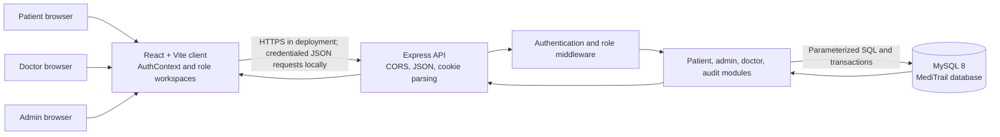

# MediTrail Architecture

MediTrail is a local academic prototype with a React/Vite browser client, an
Express API, and MySQL 8. The client does not connect directly to MySQL.

## Authentication and data flow

1. Patient registration validates input, hashes the password with bcrypt, and
   inserts the `users`, `patients`, and `audit_logs` rows in one transaction.
2. Login verifies the hash and sets a 15-minute signed JWT in an HttpOnly,
   SameSite=Lax cookie. The secret is read from the ignored local `server/.env`.
3. Every protected request validates the cookie and loads the current active
   user and role from MySQL. The client never chooses a role for registration.
4. The patient dashboard derives its patient ID from the authenticated user.
5. An administrator provisions doctors and grants or revokes doctor/patient
   access. Doctors can read or change records only while a grant is active.
6. Accepting a referral gives the receiving doctor an access grant. Referral
   status changes and clinical record changes are audited in their transaction.

The JWT is stateless, so logout clears the browser cookie but does not revoke a
copied token before its short expiry. The prototype is not a clinical system.

## Main code areas

- `client/src/context/` stores the current signed-in user in React state.
- `client/src/lib/api.js` sends requests with credentials and displays safe API
  errors to the user.
- `server/src/modules/auth/` handles registration, login, cookie validation,
  and role checks.
- `server/src/modules/admin/` provisions doctors and manages access grants.
- `server/src/modules/doctors/` handles consultations, prescriptions, and
  referrals.
- `server/src/modules/patients/` returns the signed-in patient's dashboard.
- `server/src/modules/audit/` writes audit events as part of transactions.
- `database/schema.sql` is the baseline schema; additive changes belong in
  `database/migrations/`.
