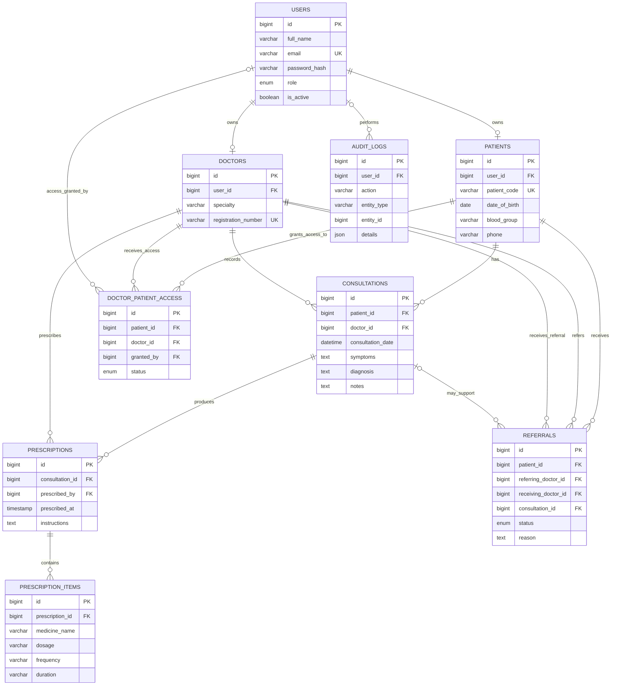

# MediTrail Entity Relationship Diagram

The access table is added by
`database/migrations/001_doctor_patient_access.sql`. A unique patient/doctor
pair is reactivated on a new grant; the audit table retains the change history.
